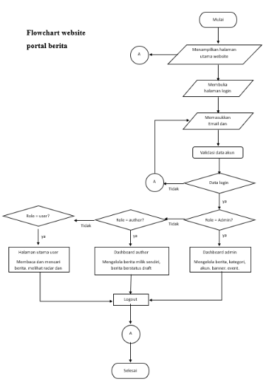
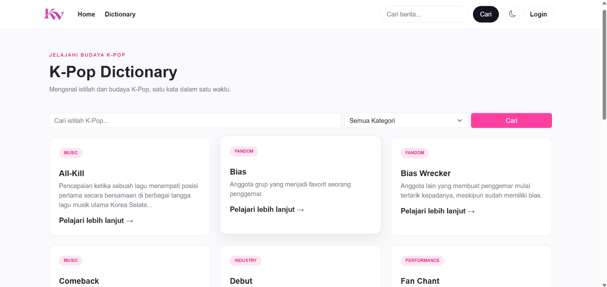
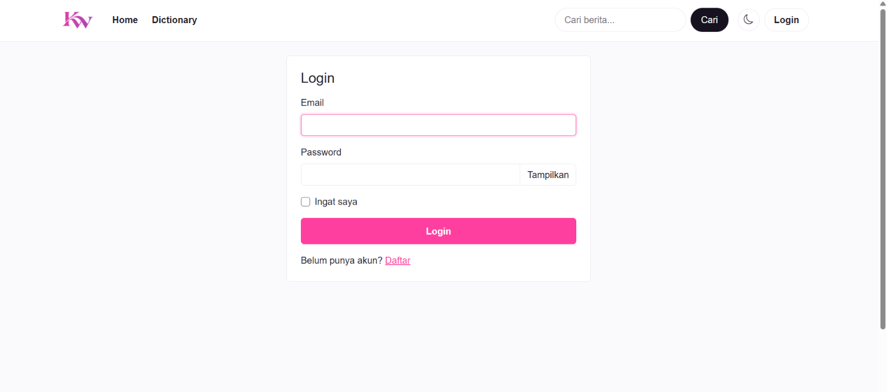

# KWave — K-Pop News Portal

**More Than Music, A Place to Belong.**

KWave adalah portal berita digital yang menyajikan informasi seputar dunia K-Pop, mulai dari berita terbaru, profil artis, hingga berbagai informasi dan agenda menarik bagi penggemar K-Pop.

## Fitur Utama

### Public Website
- Beranda dengan berita terbaru.
- Kategori berita dan pencarian.
- Detail berita.
- KWave Picks untuk berita pilihan.
- KWave Radar untuk agenda dan acara mendatang.
- K-Pop Dictionary untuk mengenal istilah dalam dunia K-Pop.
- Tampilan responsif dan dukungan dark mode.

### Admin Panel
- Mengelola berita (CRUD).
- Mengelola kategori berita.
- Mengelola banner dan berita pilihan.
- Mengelola agenda KWave Radar.
- Mengelola K-Pop Dictionary.
- Mengelola akun dan data pengguna.
- Laporan berita dalam format PDF dan Excel.

### Author Panel
- Membuat dan mengelola berita sendiri.
- Mengedit berita yang telah dibuat.
- Berita baru otomatis berstatus Draft.
- Status publikasi dikelola oleh Admin.

## User Roles

| Role | Hak Akses |
|---|---|
| Admin | Mengelola seluruh konten dan pengguna |
| Author | Membuat dan mengelola berita sendiri |
| User | Mengakses dan membaca konten publik |

## Tech Stack

- **Backend:** PHP 8.2, Laravel 12
- **Admin Panel:** Filament 5
- **Database:** MySQL
- **Frontend:** Blade, Bootstrap, CSS, JavaScript
- **Version Control:** Git & GitHub

## Installation

Pastikan PHP, Composer, Node.js, dan MySQL sudah terpasang.

1. Clone repository:

   ```bash
   git clone https://github.com/apnieee/Portal-Berita.git
   ```

2. Masuk ke folder project:

   ```bash
   cd Portal-Berita
   ```

3. Install dependencies:

   ```bash
   composer install
   npm install
   ```

4. Salin file konfigurasi:

   ```bash
   cp .env.example .env
   ```

   Untuk Windows, file `.env.example` juga bisa disalin secara manual menjadi `.env`.

5. Generate application key:

   ```bash
   php artisan key:generate
   ```

6. Atur konfigurasi database pada file `.env`, kemudian jalankan:

   ```bash
   php artisan migrate
   ```

7. Buat symbolic link untuk penyimpanan file:

   ```bash
   php artisan storage:link
   ```

8. Jalankan aplikasi:

   ```bash
   npm run build
   php artisan serve
   ```

Buka alamat lokal yang ditampilkan oleh Laravel di browser.

## Usage

KWave dapat digunakan melalui website publik maupun dashboard berdasarkan hak akses masing-masing pengguna.

### 1. Public Website
1. Buka website KWave melalui browser.
2. Pengunjung akan diarahkan ke halaman utama yang menampilkan berita terbaru.
3. Pilih kategori untuk melihat berita berdasarkan topik.
4. Gunakan fitur pencarian untuk menemukan berita tertentu.
5. Klik salah satu berita untuk membaca detail dan isi berita.
6. Kunjungi KWave Radar untuk melihat agenda dan acara mendatang.
7. Buka K-Pop Dictionary untuk mencari istilah seputar dunia K-Pop.

### 2. Admin
1. Buka halaman login KWave.
2. Masukkan email dan password akun Admin.
3. Setelah berhasil login, pengguna akan diarahkan ke dashboard Admin.
4. Pilih menu pengelolaan sesuai kebutuhan.
5. Admin dapat menambah, melihat, mengedit, dan menghapus data berita maupun kategori.
6. Admin juga dapat mengelola banner, KWave Radar, K-Pop Dictionary, dan data pengguna.
7. Admin dapat mengelola status publikasi berita serta mengunduh laporan dalam format PDF dan Excel.

### 3. Author
1. Buka halaman login KWave.
2. Masukkan email dan password akun Author.
3. Setelah berhasil login, pengguna akan diarahkan ke dashboard Author.
4. Buat berita baru melalui formulir yang tersedia.
5. Berita yang dibuat akan tersimpan dengan status Draft.
6. Author dapat melihat dan mengedit berita yang telah dibuat.
7. Publikasi berita dilakukan oleh Admin.

### 4. User
Pengunjung dapat mengakses halaman publik KWave untuk membaca berita, menjelajahi kategori, melihat agenda, dan menggunakan K-Pop Dictionary.

## Project Structure

```text
Portal-Berita/
├── app/
│   ├── Filament/
│   ├── Http/
│   └── Models/
├── bootstrap/
├── config/
├── database/
├── public/
├── resources/
│   └── views/
├── routes/
├── storage/
├── tests/
├── .env.example
├── artisan
└── composer.json
```

## Entity Relationship Diagram


## Flowchart



## Website
**KWave:** https://kwave.web.id

## Tampilan Website
### halaman utama
 


### dictionary


### halaman login


### dashboard admin


### dashboard author


## Developer
Developed by **apnieee**.

---

*KWave — Beyond the music, beyond the stage — a space where stories, connections, and shared moments find their place.*
