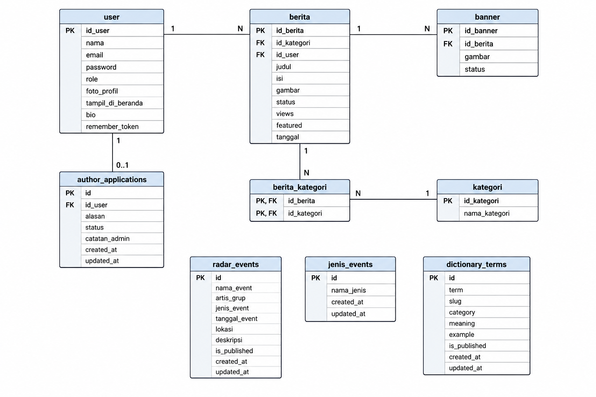

# KWave — K-Pop News Portal

**More Than Music, A Place to Belong.**

KWave adalah portal berita digital yang menyajikan informasi seputar dunia K-Pop, mulai dari berita terbaru, profil artis, hingga berbagai informasi dan agenda menarik bagi penggemar K-Pop.

## Fitur Utama

### Public Website
- Beranda dengan berita terbaru.
- Kategori berita dan pencarian.
- Detail berita.
- KWave Picks untuk berita pilihan.
- KWave Radar untuk agenda dan acara mendatang.
- K-Pop Dictionary untuk mengenal istilah dalam dunia K-Pop.
- Tampilan responsif dan dukungan dark mode.

### Admin Panel
- Mengelola berita (CRUD).
- Mengelola kategori berita.
- Mengelola banner dan berita pilihan.
- Mengelola agenda KWave Radar.
- Mengelola K-Pop Dictionary.
- Mengelola akun dan data pengguna.
- Laporan berita dalam format PDF dan Excel.

### Author Panel
- Membuat dan mengelola berita sendiri.
- Mengedit berita yang telah dibuat.
- Berita baru otomatis berstatus Draft.
- Status publikasi dikelola oleh Admin.

## User Roles

| Role | Hak Akses |
|---|---|
| Admin | Mengelola seluruh konten dan pengguna |
| Author | Membuat dan mengelola berita sendiri |
| User | Mengakses dan membaca konten publik |

## Tech Stack

- **Backend:** PHP 8.2, Laravel 12
- **Admin Panel:** Filament 5
- **Database:** MySQL
- **Frontend:** Blade, Bootstrap, CSS, JavaScript
- **Version Control:** Git & GitHub

## Installation

Pastikan PHP, Composer, Node.js, dan MySQL sudah terpasang.

1. Clone repository:

   ```bash
   git clone https://github.com/apnieee/Portal-Berita.git
   ```

2. Masuk ke folder project:

   ```bash
   cd Portal-Berita
   ```

3. Install dependencies:

   ```bash
   composer install
   npm install
   ```

4. Salin file konfigurasi:

   ```bash
   cp .env.example .env
   ```

   Untuk Windows, file `.env.example` juga bisa disalin secara manual menjadi `.env`.

5. Generate application key:

   ```bash
   php artisan key:generate
   ```

6. Atur konfigurasi database pada file `.env`, kemudian jalankan:

   ```bash
   php artisan migrate
   ```

7. Buat symbolic link untuk penyimpanan file:

   ```bash
   php artisan storage:link
   ```

8. Jalankan aplikasi:

   ```bash
   npm run build
   php artisan serve
   ```

Buka alamat lokal yang ditampilkan oleh Laravel di browser.

## Project Structure

```text
Portal-Berita/
├── app/
│   ├── Filament/
│   ├── Http/
│   └── Models/
├── bootstrap/
├── config/
├── database/
├── public/
├── resources/
│   └── views/
├── routes/
├── storage/
├── tests/
├── .env.example
├── artisan
└── composer.json
```

## Entity Relationship Diagram


## Website
**KWave:** https://kwave.web.id

## Tampilan Website
### halaman utama

 


### halaman login


## Developer

Developed by **apnieee**.

---

*KWave — Beyond the music, beyond the stage — a space where stories, connections, and shared moments find their place.*
